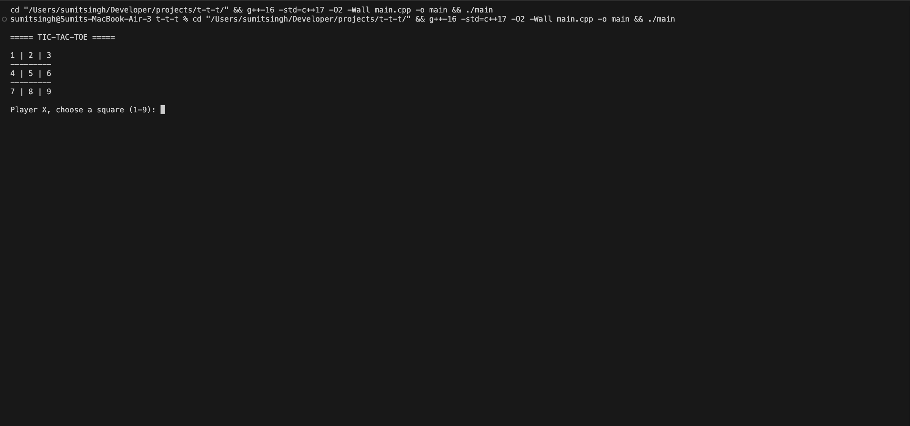

# T_T_T
### Tic-Tac-Toe, but in the Terminal!

Hey! Welcome to T_T_T!

This is my first project for **Hack Club**, and I wanted to build something a little different instead of making another generic website.

It's a classic Tic-Tac-Toe game, but instead of playing in a browser, you play directly in your terminal with another person.

It sounds relatively simple, but building it turned out to be more challenging than I expected!

## Screenshots

### Game Board


### Gameplay


### Restart Option


## Features

- Classic 3×3 Tic-Tac-Toe game.
- Two players can play together in the terminal.
- Players take turns placing X and O.
- Input validation for invalid positions.
- Prevents players from selecting already occupied cells.
- Automatically detects winning combinations (rows, columns and diagonals).
- Detects when a match ends in a draw.
- Play Again option to restart another match without restarting the application.

## How to Run

You can download the precompiled executable from the **[Releases](https://github.com/anushkasinggh11-blip/T_T_T/releases)** section.

Download the executable suitable for your operating system and run it.

### macOS Note

macOS may block downloaded executables that are not signed and notarized by an identified developer.

If you trust the source of the executable and macOS blocks it, you may need to allow it through:

1. Try opening the downloaded executable.
2. Open **System Settings → Privacy & Security**.
3. Scroll down to the Security section.
4. If macOS provides an option to allow the blocked application, review it and select Open Anyway.
5. Follow the confirmation prompts.

The exact steps can vary depending on your macOS version and security settings.

## How to Build Locally

Want to compile and run the game yourself? Follow these steps.

### Prerequisites

- C++ compiler (Clang or GCC).
- Git installed on your system.
- Terminal.

### Steps

**1. Clone the repository**

```bash
git clone https://github.com/anushkasinggh11-blip/T_T_T.git
```

**2. Navigate to the project directory**

```bash
cd T_T_T
```

**3. Compile the C++ code**

For macOS (Clang):

```bash
clang++ -std=c++17 -Wall -Wextra main.cpp -o tictactoe
```

Alternatively, using GCC:

```bash
g++ -std=c++17 -Wall -Wextra main.cpp -o tictactoe
```

**4. Run the game**

For macOS/Linux:

```bash
./tictactoe
```

For Windows, compile using:

```bash
g++ -std=c++17 -Wall -Wextra main.cpp -o tictactoe.exe
```

Then run:

```bash
.\tictactoe.exe
```

## How to Play

1. Player X goes first.
2. Player O plays after X.
3. Enter a number between 1 and 9 to select a position.
4. Players continue taking turns.
5. Get three marks in a row, column, or diagonal to win.
6. If all nine positions are filled without a winner, the match ends in a draw.
7. After the match, enter `y` to play again or `n` to exit.

### Board Layout

```text
1 | 2 | 3
---------
4 | 5 | 6
---------
7 | 8 | 9
```

## Challenges I Faced

This project was relatively simple in concept, but I faced a few challenges while building it.

- Initially, I couldn't compile the C++ code correctly.
- Getting the application to run on another person's machine was another challenge.
- Handling invalid inputs and occupied positions required additional validation.
- Implementing all eight winning combinations took some thought.
- I also wanted the game to restart without requiring the user to launch the executable again.

Working through these problems helped me understand more than just writing code that works on my own machine.

## What I Learned

- Working with arrays and functions in C++.
- Handling terminal input using `getline` and `istringstream`.
- Using loops and conditional statements to control game flow.
- Implementing winning and draw conditions.
- Understanding how to compile C++ code into an executable.
- Using Git and GitHub to track project development.

## AI Usage

I used AI as a learning assistant during this project.

Mainly, I used it to:
- Understand how to build and compile C++ executables.
- Debug logical and syntax errors.
- Understand implementation approaches and improve the game.

## License

This project is licensed under the MIT License. See the [LICENSE](LICENSE) file for details.

---

Made with C++ and a lot of debugging!