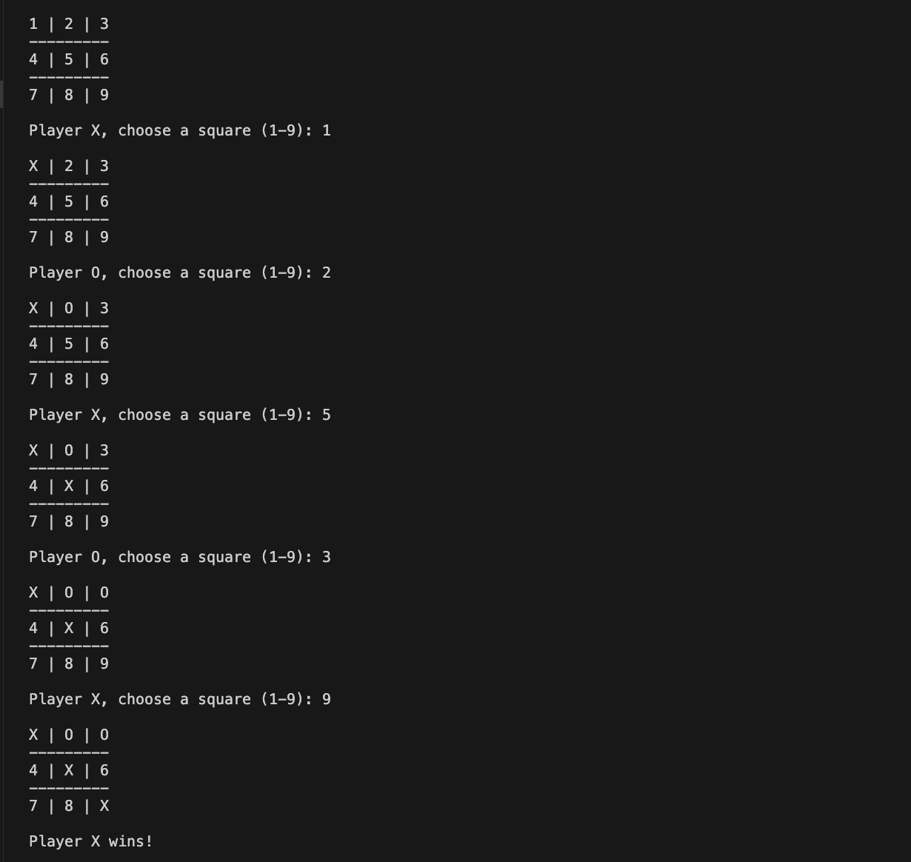
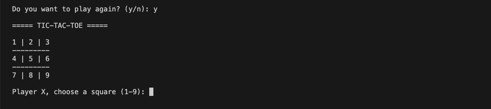

# T_T_T

### Tic Tac Toe but in terminal

This is my first project for Hack Club

I wanted to make something different instead of making a website so I made this simple tic tac toe game using C++

It looked simple but i faced some problems while compiling it and making it work on my friends machine

## Screenshots

### Game Board


### Gameplay


### Restart


## Features

- two players can play
- X and O turns
- checks wrong input
- checks if a position is already filled
- detects winner and draw
- play again option

## Challenges

- first i was not able to compile the code
- then the game was not running on my friends machine
- had some issues with user input
- checking all winning conditions was a bit confusing
- making the restart option work without closing the game

## How to run

Download the game from the [Releases](https://github.com/anushkasinggh11-blip/T_T_T/releases) section

Or build it yourself

```bash
git clone https://github.com/anushkasinggh11-blip/T_T_T.git
cd T_T_T
clang++ -std=c++17 -Wall -Wextra main.cpp -o tictactoe
./tictactoe
```

## What I learned

- basic C++
- arrays and functions
- taking user input
- using loops and conditions
- making an executable
- using git and github

## AI usage

Used AI to understand how to make C++ executables and to fix some logic and syntax errors

## License

MIT License
